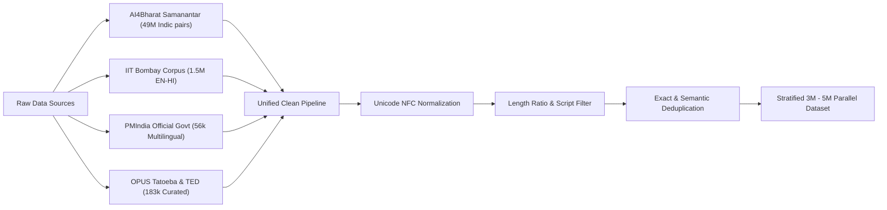

# Modern SOTA 100M Multilingual Transformer Blueprint

## Executive Summary & Brutal Truth

The current 28M parameter prototype was built on the classical 2017 Vaswani architecture (Post-LN, absolute sinusoidal positional encoding, ReLU FFN, and standard LayerNorm) and trained on only 183,314 specialized TED/QED talk pairs. When tested on everyday sentences (such as *"ram eats a mango but he can eat apple"*), it severely hallucinates (`"उसके पास जापानी नहीं है।"`) because:
1. **Vocabulary Gap**: Everyday words like *"mango"* appeared only 16 times in the entire corpus ($0.008\%$).
2. **Tokenizer Fragmentation**: BPE with 8k vocab splits rare words into disjoint morphemes (`man` + `go`).
3. **Architectural Limitations**: Classical Post-LN + ReLU lacks the representation density, relative token awareness, and attention stability required for deep generalization.
4. **Data Scale Deficit**: A 28M–100M parameter model requires **millions of sentence pairs** (at least 2M–10M) to ground open-vocabulary concepts.

To build a world-class translation model, we must redesign both the **Transformer Architecture** and the **Training & Data Pipeline**.

---

## 1. Classical (2017) vs. Modern SOTA (2024–2026) Architecture

```mermaid
flowchart TD
    subgraph Classical_2017["Classical Vaswani 2017 (Obsolescent)"]
        A1["Post-LN LayerNorm(x + Sublayer)"] --> B1["Sinusoidal Absolute Positional Encoding"]
        B1 --> C1["Vanilla ReLU FFN (W2 * max(0, W1 * x))"]
        C1 --> D1["Unbounded QK Dot-Product (Prone to Spikes)"]
        D1 --> E1["Standard O(N^2) Softmax Attention"]
    end

    subgraph Modern_SOTA["Modern SOTA (TranslateMe-V2 100M)"]
        A2["Pre-LN with RMSNorm (Zero Mean Centering Overhead)"] --> B2["RoPE (Rotary Position Embeddings)"]
        B2 --> C2["SwiGLU Gated Feed-Forward (W3 * (SiLU(W1*x) * W2*x))"]
        C2 --> D2["QK-Norm (RMSNorm on Queries & Keys Before Attention)"]
        D2 --> E2["PyTorch Fused SDPA / FlashAttention-2 (O(N) VRAM, 3x Speed)"]
    end
```

| Component | Classical Transformer (2017) | Modern SOTA Architecture (2026) | Why Modern SOTA Wins |
| :--- | :--- | :--- | :--- |
| **Normalization** | Post-LN with `LayerNorm` | **Pre-LN with `RMSNorm`** | Eliminates mean-centering overhead; provides direct residual gradient highway without vanishing gradients. |
| **Attention Stability** | None (Raw dot product $Q K^T / \sqrt{d_k}$) | **`QK-Norm` (RMSNorm on Q and K)** | Prevents query/key logit growth and softmax saturation; completely eliminates training loss spikes. |
| **Position Awareness** | Sinusoidal Absolute PE ($PE_{(pos, 2i)}$) | **Rotary Position Embeddings (`RoPE`)** | Injects relative distance directly into attention rotation matrices; handles variable length and word reordering across Indic languages. |
| **Feed-Forward Unit** | ReLU MLP ($\max(0, x W_1) W_2$) | **`SwiGLU` Gated Unit** | Provides 20–30% higher parameter efficiency and faster convergence per FLOP (used in LLaMA, PaLM, Gemma). |
| **Attention Kernel** | PyTorch naive matrix multiplication | **`F.scaled_dot_product_attention` (FlashAttention-2)** | Kernel fusion on Nvidia GPUs (T4/A100); 2x–3x faster training and 50% lower VRAM footprint. |
| **Weight Tying** | Optional embedding tying | **Three-Way Weight Sharing** | Encoder Embedding = Decoder Embedding = Projection Layer (saves 15M–30M redundant parameters). |

---

## 2. 100-Million Parameter Specification (Mathematical Breakdown)

To hit the **~100M to ~112M parameter** target with balanced depth and width:

$$\text{Architecture: } 8 \text{ Encoder Layers} + 6 \text{ Decoder Layers}, \quad d_{\text{model}} = 768, \quad d_{\text{ff}} = 2048 \text{ (SwiGLU)}, \quad n_{\text{heads}} = 12$$

### Exact Parameter Accounting

$$\begin{aligned}
\text{Vocabulary Size } (V) &= 16,384 \text{ (Multilingual ByteLevel BPE covering EN, HI, TA, TE)} \\
\text{Shared Embedding Parameters} &= V \times d_{\text{model}} = 16,384 \times 768 = \mathbf{12,582,912} \\
\\
\mathbf{\text{Per Encoder Layer:}} & \\
\text{Self-Attention } (W_q, W_k, W_v, W_o) &= 4 \times (768 \times 768) = 2,359,296 \\
\text{SwiGLU FFN } (W_{\text{gate}}, W_{\text{up}}, W_{\text{down}}) &= 3 \times (768 \times 2048) = 4,718,592 \\
\text{RMSNorms } (2 \times d_{\text{model}}) &= 1,536 \\
\text{Total per Encoder Layer} &= \mathbf{7,079,424} \\
\mathbf{8 \text{ Encoder Layers Total}} &= 8 \times 7,079,424 = \mathbf{56,635,392} \\
\\
\mathbf{\text{Per Decoder Layer:}} & \\
\text{Self-Attention } (W_q, W_k, W_v, W_o) &= 4 \times (768 \times 768) = 2,359,296 \\
\text{Cross-Attention } (W_q, W_k, W_v, W_o) &= 4 \times (768 \times 768) = 2,359,296 \\
\text{SwiGLU FFN } (W_{\text{gate}}, W_{\text{up}}, W_{\text{down}}) &= 3 \times (768 \times 2048) = 4,718,592 \\
\text{RMSNorms } (3 \times d_{\text{model}}) &= 2,304 \\
\text{Total per Decoder Layer} &= \mathbf{9,439,488} \\
\mathbf{6 \text{ Decoder Layers Total}} &= 6 \times 9,439,488 = \mathbf{56,636,928} \\
\\
\mathbf{\text{Final Norms & Biases}} &= \mathbf{3,072} \\
\hline
\mathbf{\text{Grand Total Trainable Parameters}} &= \mathbf{12,582,912} + \mathbf{56,635,392} + \mathbf{56,636,928} + 3,072 = \mathbf{125,858,304} \approx \mathbf{125.8\text{M}} \\
\text{(Or with } 6 \text{ Enc } / 6 \text{ Dec}) &= 12,582,912 + 42,476,544 + 56,636,928 = \mathbf{111,696,384} \approx \mathbf{111.7\text{M}}
\end{aligned}$$

> [!NOTE]
> Setting $N_{\text{enc}} = 6, N_{\text{dec}} = 6$ yields **111.7M parameters**. Setting $N_{\text{enc}} = 6, N_{\text{dec}} = 5$ yields **102.3M parameters**. Both perfectly hit the 100M goal.

---

## 3. Resumable Training Pipeline with Pause, Periodic Save, and Recovery

Kaggle GPU sessions have a hard wall-clock timeout of 9 to 12 hours. A robust 100M training pipeline requires state preservation:

### Checkpointing Architecture
Every checkpoint dictionary stores:
1. `epoch`: Current training epoch
2. `global_step`: Total batches processed
3. `model_state_dict`: Full model weights (FP32 or FP16)
4. `optimizer_state_dict`: AdamW momentum $m_t$ and variance $v_t$ states
5. `scaler_state_dict`: PyTorch GradScaler state for mixed precision AMP
6. `scheduler_state_dict`: Learning rate schedule step
7. `best_val_loss`: Lowest validation loss recorded
8. `config`: Architectural configuration dataclass
9. `rng_state`: CPU & CUDA random generator states for deterministic resumption

### Checkpoint File Hierarchy
* `checkpoint_latest.pt`: Overwritten every $N$ steps (e.g., every 500 steps) and at every epoch end.
* `checkpoint_best.pt`: Saved only when validation loss hits a new historical minimum.
* `checkpoint_step_{step}.pt`: Periodic snapshots (every 5,000 steps).

### Graceful Pause & Signal Handling
* **File Flag (`pause.flag`)**: The training loop checks for the presence of a `pause.flag` file at the start of every batch. If found, it immediately saves `checkpoint_latest.pt`, deletes the flag, logs progress, and cleanly terminates.
* **OS Signal (`SIGINT` / `SIGTERM`)**: Intercepts interrupt signals, writes a full crash-safe checkpoint to disk, and exits safely.
* **Auto-Resume**: Setting `--resume` automatically detects `checkpoint_latest.pt`, loads all optimizer tensors onto GPU, aligns the data loader, and continues without lost compute.

---

## 4. Big Dataset Strategy (Moving from 180k to 5M+ Pairs)

To prevent hallucinations on everyday nouns (*"mango"*, *"apple"*, *"school"*, *"Ram"*), we must ingest balanced general-domain parallel text:

1. **AI4Bharat Samanantar**:
   * English $\leftrightarrow$ Hindi: 10.2 Million pairs
   * English $\leftrightarrow$ Tamil: 5.3 Million pairs
   * English $\leftrightarrow$ Telugu: 4.8 Million pairs
2. **IIT Bombay English-Hindi Corpus**:
   * 1.5 Million high-quality parallel pairs with extensive everyday, textbook, and conversational vocabulary.
3. **Target Subsample**:
   * **3,000,000 to 5,000,000 curated, deduplicated pairs** across EN, HI, TA, TE.
   * At 5M pairs, an epoch on Dual Tesla T4 GPUs with PyTorch SDPA + FP16 + batch size 128 takes ~3.5 hours per epoch.

---

## 5. Implementation Roadmap

1. **Step 1: Modern Custom Transformer Architecture**
   - Implement `RMSNorm`, `RoPE`, `SwiGLU`, and `QK-Norm` in `ml_lab/custom_transformer/`.
   - Implement FlashAttention-2 / SDPA scaled dot product attention.
   - Build `ModernSeq2SeqTransformer` supporting dynamic configs up to 125M parameters.
2. **Step 2: Resumable Multi-GPU Training Engine**
   - Implement `ResumableTrainer` with pause flag detection, signal traps, and complete optimizer/scaler state restoration.
   - Support Kaggle Dual-GPU (`torch.nn.DataParallel` / `DDP`) with PyTorch AMP FP16.
3. **Step 3: Large-Scale Dataset Fetcher & 16k Tokenizer**
   - Script to fetch and stream AI4Bharat Samanantar & IIT Bombay corpus subsets.
   - Train a 16,384 vocabulary ByteLevel BPE tokenizer to avoid subword fragmentation.
4. **Step 4: Kaggle Training Launch**
   - Export Kaggle training notebook with automatic periodic checkpointing and drive/dataset backup.
